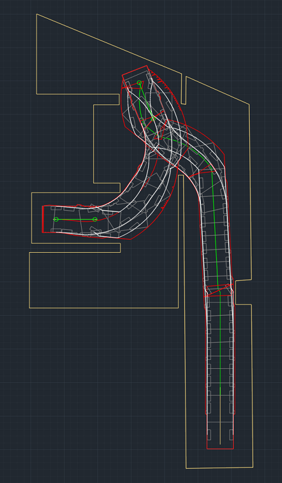
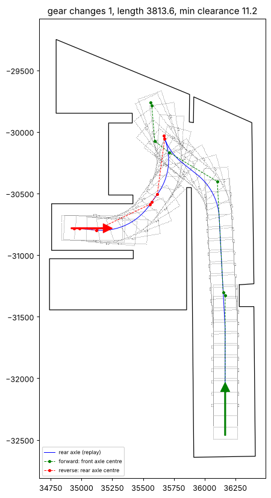

# Example: plan a car route inside a boundary and check it with a swept path

This example shows how Claude combines the ZWCAD MCP tools with its own computation to solve a task
that no single tool covers: **find a collision-free route for a car from a start vector to an end
vector inside a closed boundary, draw it, and prove it with the vehicle swept path**.

> **Correction (2026-10-25, FINDINGS #57).** The forward part of the routes on this page is **not drivable**:
> the front-axle path has tangent breaks of 31.6° and 63.2°, i.e. the steered wheels would have to jump from
> lock to lock while moving. The planner used a rigid-arc model of the rear axle; QuickTurn / CAYENNE guide the
> FRONT axle along a tangent-continuous path (straights + arcs with R ≥ wheelbase / sin(lock), as SCIEZKA's
> fillets and QuickTurn2's dynamic path do) and move the car by the tractrix. `vehicle_swept_path` reported
> "feasible" because it only checked the size of the steering angle, not its continuity; it now reports
> `steering_continuous` / `max_steer_change_per_step_deg`, and `plan_vehicle_route` now plans in the QuickTurn model
> (see below); when the margin cannot be kept it returns the drivable route together with the boundary edges that
> would have to be violated, and `draw_vehicle_route` marks them on layer `SP_NARUSZENIE`.

**Since 2026-10-25 the server does this itself:** `plan_vehicle_route` → `draw_vehicle_route` (see
[Using the tools](#using-the-tools)). The rest of this page documents the first run, done with the scripts in
this folder before the tools existed; `plan_route.py` stays as a stand-alone reference implementation.



*Result in ZWCAD Standard 2024: boundary (yellow), swept envelopes with mirrors (red), tyre tracks
and car outlines every 2 m (white), front / rear axle end positions (green). The forward route runs up the
lane on the right and turns left to the north; the car then reverses in an arc into the bay on the left.
Zero intersections with the boundary, minimum clearance 10.7 cm.*

## How plan_vehicle_route works now (QuickTurn model)

1. **Corridor** (`route_rigid.py`): fast hybrid A* in a simplified rigid model finds where the car can go and where
   to change gear (a few seconds). Its path is *not* drawn: it may need instant steering changes.
2. **Drivable route** (`route_qt.py`), built like QuickTurn2's dynamic path (`QT:DRAWDPATH`): the guided axle
   follows arcs that start in the direction the wheels point, so the path is tangent-continuous, with
   R >= wheelbase / sin(lock) (front axle 553 cm for the Cayenne, rear 471 cm); the car moves by the exact tractrix
   (`QT:GETALIST`, the same step as `vehicle_swept_path`). The "clicked points" are placed automatically around
   the corridor by a beam search; the last piece reaches the end vector exactly (reverse) or with <= 3 deg heading
   lag (forward).
3. **Margin not possible?** The least-violating drivable route is returned with `violations`: each boundary edge
   the car comes closer to than `margin_mm` (or crosses), the affected part of the edge and the depth.
   On the SOJ example: 5 edges, deepest 18 cm beyond the end of the inner wall of the lane.

## Using the tools

```text
count_entities / select_entities  {"layers": ["Cayenne limits", "Cayenne start", "Cayenne end"]}  -> handles
plan_vehicle_route {"boundary_handle": "11679A", "start_handle": "11679D", "end_handle": "11679E"}
    -> {"plan_id": "ROUTE001", "status": "running" | "done", "result": {...}}
get_vehicle_route_plan {"plan_id": "ROUTE001"}            # only while status is "running"
draw_vehicle_route {"plan_id": "ROUTE001"} dry_run=false confirm=true
    -> paths, swept_path (feasible, steering), collision_check (intersections, min distance), verified
get_screenshot
```

- Vector convention: tail → head is the direction the car faces; the midpoint is the body centre
  (`anchor="centre"`, or `"rear_axle"` / `"front_axle"` = the tail is that axle).
- `allow_reverse=false` checks forward-only driving. For this drawing the answer comes in 0.3 s: impossible,
  because the end vector points out of a 3.8 m wide dead-end bay and the car cannot turn round inside it.
- With reversing allowed the planner first finds any route (a few seconds), then searches again for fewer gear
  changes within `time_budget_s` (default 120 s, in the background).

## The prompt

> Using ZWCAD MCP:
> 1. in the open drawing find the boundary on layer "Cayenne limits",
> 2. find the vector on layer "Cayenne start",
> 3. find the vector on layer "Cayenne end".
>
> Inside the boundary (1) draw the vehicle route from the start (2) to the end (3), avoiding any
> collision with the boundary (1).

Conventions used by the example (stated in the answer, adjustable in `plan_route.py`):

- a vector is a two-point LWPOLYLINE; tail → head is the direction the car faces;
- the vector midpoint is the centre of the car body;
- vehicle: Porsche Cayenne E3 (the defaults of `vehicle_swept_path`), body **with mirrors**;
- clearance to the boundary: at least 10 cm (`--margin`).

## Steps and tool calls

| # | Step | Tool | Notes |
|---|------|------|-------|
| 1 | Check the drawing is not blocked | `list_cad_dialogs`, `get_current_document` | units: `INSUNITS` = 5 (cm) |
| 2 | Find the three objects | `count_entities` `{"layers": ["Cayenne*"]}`, `group_by: ["layer","type"]` | 3 × LWPOLYLINE, 0.4 s via LISP |
| 3 | Read vertices and bulges | `execute_lisp` (read-only `ssget` + `entget`) | see snippet below; `input_example.json` |
| 4 | Plan the route | local Python: `plan_route.py` | hybrid A* + Dubins tail, body+mirror collision check |
| 5 | Preview | local Python: `plot_route.py` | `route_example.png` |
| 6 | Draw one polyline per gear | `execute_lisp` (code from `to_lisp.py`), `undo=true` | arcs as bulges, layer "Cayenne route" |
| 7 | Swept path, forward part | `vehicle_swept_path` `direction=forward`, `auto_fillet=false`, `units=cm` | path = front axle centre |
| 8 | Swept path, reverse part | `vehicle_swept_path` `direction=reverse`, `auto_fillet=false`, `units=cm` | path = rear axle centre |
| 9 | Prove no collision | `execute_lisp`: `IntersectWith` envelope × boundary, min. distance | must be 0 intersections |
| 10 | Look at it | `zoom_view`, `get_screenshot` | `SP_*` layers that were off are switched on (`result.layers`) |

Read step (3), wrapped in a `lambda` with local variables (see *Pitfalls*):

```lisp
((lambda ( / ss i e d vs out)
  (setq ss (ssget "_X" '((0 . "LWPOLYLINE") (8 . "Cayenne*"))) i 0)
  (while (< i (sslength ss))
    (setq e (ssname ss i) d (entget e) vs nil)
    (foreach g d
      (cond ((= (car g) 10) (setq vs (cons (list (cadr g) (caddr g)) vs)))
            ((= (car g) 42) (setq vs (cons (list "b" (cdr g)) vs)))))
    (setq out (cons (list (cons "handle" (cdr (assoc 5 d))) (cons "layer" (cdr (assoc 8 d)))
                          (cons "data" (reverse vs))) out)
          i (1+ i)))
  (list (cons "insunits" (getvar "INSUNITS")) (cons "items" out))))
```

Collision proof (9):

```lisp
((lambda ( / lim env ip n e dmin p d out)
  (setq lim (vlax-ename->vla-object (handent "<boundary handle>")))
  (foreach h '("<envelope 1>" "<envelope 2>")
    (setq env (vlax-ename->vla-object (handent h))
          ip  (vlax-variant-value (vla-IntersectWith env lim acExtendNone))
          n   (if (> (vlax-safearray-get-u-bound ip 1) 0) (/ (1+ (vlax-safearray-get-u-bound ip 1)) 3) 0)
          e (handent h) dmin 1e99)
    (foreach g (entget e)
      (if (= (car g) 10)
        (setq p (list (cadr g) (caddr g) 0.0)
              d (distance p (vlax-curve-getClosestPointTo lim p))
              dmin (min d dmin))))
    (setq out (cons (list (cons "envelope" h) (cons "intersections" n) (cons "min_dist" dmin)) out)))
  (reverse out)))
```

## How the planner works (`plan_route.py`)

- **State**: rear axle centre `(x, y, heading)`, kinematic bicycle model.
- **Motion primitives**: 25 cm arcs with full left lock, straight, full right lock, forward and reverse.
  The planning radius is 95 % of the minimum rear-axle radius (447 cm for the Cayenne, from the
  turning circle 12.1 m), so the LISP simulation never needs more steering than the car has.
- **Collision check**: the whole body outline *with mirrors* is sampled every 10 cm and looked up in a
  signed distance field of the boundary (5 cm grid); every sample must be ≥ the margin inside.
- **Heuristic**: obstacle-aware 2D distance (Dijkstra on the free grid from the goal).
- **Analytic tail**: near the goal the search tries an exact Dubins connection (in the current gear;
  reversing = Dubins of the flipped car), checked for collisions, so the end pose is hit exactly.
- **Gear changes** cost extra and are only allowed between straight pieces. Each drawn segment
  therefore starts tangent to the car axis, which is what the LISP swept-path simulation assumes.
- **Output**: per gear one LWPOLYLINE with bulges. Forward segments are written as the **front axle
  centre** path (concentric arcs of the rear-axle arcs), reverse segments as the **rear axle centre**
  path, in the order of travel — exactly what `vehicle_swept_path` expects.

```
python plan_route.py input_example.json route_example.json --margin 10 --step 25
python plot_route.py input_example.json route_example.json route_example.png
python to_lisp.py route_example.json "Cayenne route" > route.lsp   # paste into execute_lisp
```

Needs numpy, scipy and matplotlib. Runtime on this example: about 5 minutes (pure Python,
175 000 expansions); a coarser `--step` is faster but finds fewer manoeuvres.

## Result of the run (2026-10-25, ZWCAD Standard 2024)

| | Forward | Reverse |
|---|---|---|
| Path drawn as | front axle centre | rear axle centre |
| Length | 25.3 m | 12.9 m |
| Required / max. steering (`vehicle_swept_path`) | 31.58° / 32.90° | 31.58° / 32.90° |
| `feasible`, overshoot places | true, 0 | true, 0 |
| Envelope × boundary intersections | 0 | 0 |
| Min. distance envelope → boundary | 10.7 cm | 11.5 cm |

- One gear change: forward up the lane, left through the opening and on to the north, then reverse
  in an arc into the bay, ending nose-out as the end vector requires.
- The rear axle at the end of the forward simulation matched the planned start of the reverse
  segment within 2 mm; the final rear axle matched the end vector pose within 1 mm.



## Pitfalls found on the way (fixed in the server, FINDINGS #49-#52)

- **#50 LISP runner variables.** AutoLISP is dynamically scoped; `execute_lisp` code that did
  `(setq res ...)` at top level overwrote a local of `zwmcp:run`, the result was lost and the server
  reported a misleading "did not start within 10 s". The runner's locals are now prefixed
  (`zwmcp:%res` ...), and a request that ran without writing a result is reported as such. Keeping your
  own variables local, `((lambda ( / a b) ...))`, is still good practice.
- **#49 `query_entities` ignored unknown keys** (`layers`, `entity_types`) and returned the first 200
  entities of the drawing. Unknown keys are now rejected, and `layers` (wildcards) and `entity_types`
  lists are supported.
- **#51 `create_entities_batch` drew LWPOLYLINE arcs as chords.** Vertices now accept `[x, y, bulge]`
  (or a `bulges` list). `to_lisp.py` uses `entmake`, which works with older server versions too.
- **#52 `vehicle_swept_path` drew on `SP_*` layers that were off**, so nothing was visible. Existing result
  layers that are off or frozen are now switched on (`show_layers=true`, default) and listed in
  `result.layers`.
- **`auto_fillet=false`** for planned paths: they have no sharp corners, and rounding would change them.
- **Hybrid A* binning**: one primitive must turn the car by at least one heading bin, otherwise curved
  successors are pruned as duplicates of the straight one and the search never turns.
